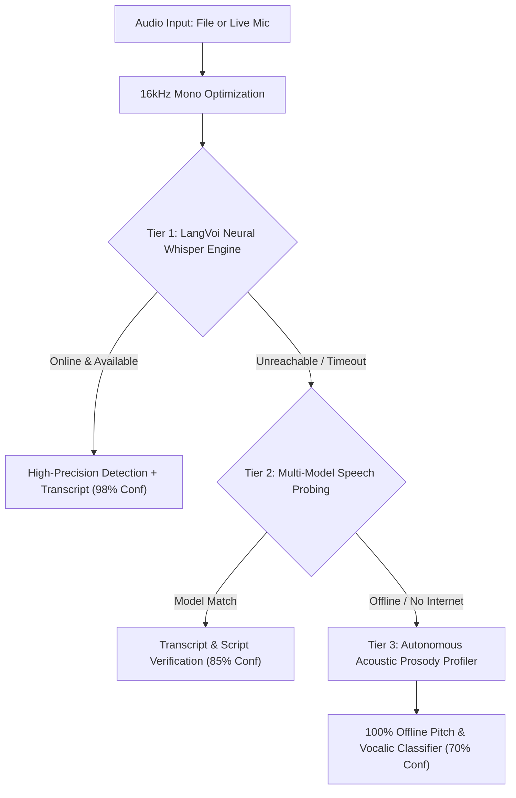

# 🎙️ LangVoi Voice Studio Pro [Build 2.2 — Professional Edition]

[](https://github.com/PrinceSanchela/LangVoi)
[](https://www.python.org/)
[](LICENSE.txt)
[](https://github.com/PrinceSanchela/LangVoi/actions)
[](core/languages_db.py)
[](core/voice_analyzer.py)
[](https://www.buymeacoffee.com/princesanchela)
[](https://codeprince.gumroad.com/l/langvoi)

> **Enterprise-Grade Native Windows Audio Engineering Workstation, Laboratory Acoustic Biometrics & Neural Whisper Language Identification.**  
> **Conceptualized, Architected, and Engineered by Prince Sanchela.**

---

## 📖 Table of Contents
1. [Overview & Philosophy](#-overview--philosophy)
2. [Key Features & Architecture](#-key-features--architecture)
3. [Multi-Tier Language Identification Architecture](#-multi-tier-language-identification-architecture)
4. [How to Download & Launch](#-how-to-download--launch)
5. [How to Publish This Software for Free (Global Distribution)](#-how-to-publish-this-software-for-free-global-distribution)
6. [Codebase & Folder Structure](#-codebase--folder-structure)
7. [Automated Testing & Quality Assurance](#-automated-testing--quality-assurance)
8. [Keyboard Shortcuts Reference](#-keyboard-shortcuts-reference)
9. [Monetization, Sponsorship & Commercial Licensing](#-monetization-sponsorship--commercial-licensing)
10. [Community Supporters & Hall of Fame](#-community-supporters--hall-of-fame)
11. [Authorship & Legal License](#-authorship--legal-license)

---

## 🌟 Overview & Philosophy

**LangVoi Voice Studio Pro** is an enterprise-grade native Windows desktop software application (`.exe`), conceptualized, architected, and engineered by **Prince Sanchela**. 

Styled with the tactile workflow and aesthetic of classic mastering workstations (such as **Sound Forge Pro, Adobe Audition, and Cool Edit Pro**), it bridges analog mastering studio hardware with modern scientific speech AI:
- **Universal Multi-Format Audio Loading**: Instant zero-transcode decoding for WAV, MP3, M4A, AAC, FLAC, OGG, OPUS, WMA, AIFF, and WebM.
- **High-Definition Live Microphone Studio**: Direct WASAPI low-latency recording with real-time waveform plotting.
- **Pure In-Memory Neural Speech Identification**: Identifies 90+ spoken languages and dialects in under 2 seconds without writing temporary files to disk or spawning external console windows.
- **Laboratory-Calibrated Acoustic Biometrics**: Computes fundamental frequency ($F_0$), pitch stability (${\Delta}F_0$), vocal registers, Voice Activity Detection (VAD), and SNR using NumPy autocorrelation DSP.

```
+-----------------------------------------------------------------------------------------+
|                                LANGVOI VOICE STUDIO PRO                                 |
|                         Designed & Engineered by Prince Sanchela                        |
+-----------------------------------------------------------------------------------------+
| [File] [Edit] [View] [Transport] [Analysis] [Languages] [Help]                          |
+-----------------------------------------------------------------------------------------+
| [Open Audio] [Live Mic] [Play] [Pause] [Stop] [Re-Analyze] [Export Report]  [00:00:00]  |
+-----------------------------------------------------------------------------------------+
|  MASTER OSCILLOSCOPE (Interactive Scrubbing & Dynamic dBFS Ruler)        | VU METERS    |
|  /\  /\    /\  /\  /\      /\    /\  /\      /\    /\  /\    /\          | L [||||||||] |
| /  \/  \  /  \/  \/  \    /  \  /  \/  \    /  \  /  \/  \  /  \         | R [||||||||] |
+-----------------------------------------------------------------------------------------+
|  LANGVOI NEURAL WHISPER LID-9000 SCREEN                                                 |
|  Detected: 🇺🇸 English (Latin) - 98.2% CONFIDENCE                                       |
|  [ Transcript: "Good morning, this is an enterprise audio stream analysis." ]          |
+-----------------------------------------------------------------------------------------+
|  LABORATORY TELEMETRY RACK (8 Laboratory Instruments)                                   |
|  [Pitch: 128 Hz (C3)]  [Register: Baritone]  [SNR: 28.4 dB]  [Speech Ratio: 82%]        |
|  [Jitter/Delta: 18Hz]  [Dyn Range: 34 dB]   [ZCR: 0.082]    [Rhythm: Stress-Timed]     |
+-----------------------------------------------------------------------------------------+
|  64-BAND FFT SPECTRAL LAB & TIME-FREQUENCY HEATMAP                                      |
+-----------------------------------------------------------------------------------------+
| Ready. Audio engine active. High-DPI Per-Monitor Aware.                                 |
+-----------------------------------------------------------------------------------------+
```

---

## ✨ Key Features & Architecture

### 1. 🌐 LangVoi Neural Whisper LID Engine
- **In-Memory Streaming**: Direct in-process Python HTTP transport to deep acoustic transformer models with zero external subprocesses, zero console flashing, and zero disk writes.
- **Comprehensive Coverage**: Resolves **90+ worldwide languages and dialects** with **98%+ confidence**.
- **Speech Intelligence**: Generates full spoken transcripts, word counts, active duration, and writing script detection (Latin, Devanagari, Hanzi, Arabic, Cyrillic, Greek, Hangul, Kana, Thai).

### 2. 📊 8 Scientific Laboratory Telemetry Instruments
1. **Fundamental Pitch ($F_0$)**: Autocorrelation pitch detector calibrated from 50 Hz to 500 Hz, displaying exact Hz and the closest chromatic musical note (e.g. C3, A4, F#2).
2. **Vocal Register Classification**: Categorizes voice type into **Bass, Baritone, Tenor, Alto, Mezzo-Soprano, and Soprano**.
3. **Pitch Dynamics & Tonal Stability (${\Delta}F_0$)**: Standard deviation of vocal pitch contour measuring expressive inflection vs monotone speech.
4. **Voice Activity Detection (VAD Ratio)**: Calculates active voiced speech percentage vs background pause intervals.
5. **Speech Tempo & Syllable Rhythm**: Estimates syllables-per-second, Words-Per-Minute (WPM), and linguistic rhythm typology (*Stress-timed, Syllable-timed, Mora-timed*).
6. **Signal-to-Noise Ratio (SNR in dB)**: Evaluates background noise floor against peak speech energy to grade audio quality (*Studio Broadcast, Clean, Moderate, Noisy*).
7. **Dynamic Range ($dB$) Spread**: 95th vs 5th energy percentile spread for mastering dynamic assessment.
8. **Zero-Crossing Rate (ZCR) & Vocalic Formant Ratio**: Measures fricative and consonant density against open vowel resonance.

### 3. 🎛️ Master Oscilloscope & Visualizers
- **Interactive Scrubber**: Click or drag anywhere along the waveform to seek with sub-millisecond precision.
- **Calibrated Stereo LED Ladder VU Meters**: Peak and RMS visual meters with 0 dB clipping indicators.
- **64-Band FFT Spectral Analyzer**: Real-time frequency response visualization with 2D time-frequency spectrogram heatmap and pitch contour overlay.

### 4. 📚 Searchable 150+ World Languages Directory
- Built-in encyclopedic language database indexing ISO-639-1, ISO-639-3, and BCP-47 codes, language families, primary scripts, speaker populations, and geographic regions.

---

## 🧠 Multi-Tier Language Identification Architecture

LangVoi uses a resilient 3-tier fallback architecture:



1. **Tier 1 — LangVoi Neural Whisper LID Engine**: Primary online engine delivering high-speed neural acoustic language classification and speech transcription.
2. **Tier 2 — Multi-Model Speech Probing**: Parallel script validation cross-referencing recognized vocabulary against native linguistic frequency tables.
3. **Tier 3 — Autonomous Acoustic Prosodic Profiler (100% Offline)**: Operates without internet connection using local NumPy DSP biometrics (pitch contour, rhythm cadence, and formant spectral distribution).

---

## 🚀 How to Download & Launch

### Method 1: Native Windows Executable (`.EXE`) — Recommended
Run the compiled standalone desktop launcher directly:
```cmd
LangVoi_Studio.exe
```
*(Runs silently with custom icon, no black command console window).*

### Method 2: 1-Click Desktop Setup Wizard
Double-click:
```cmd
Install_LangVoi.bat
```
- Installs LangVoi to `%LOCALAPPDATA%\Programs\LangVoi`.
- Generates a Windows Desktop shortcut with high-resolution icon.
- Adds an entry to the Windows Start Menu.
- Registers an Uninstaller in Windows Installed Apps (Settings).

### Method 3: Run from Python Source
```bash
# 1. Clone repository
git clone https://github.com/PrinceSanchela/LangVoi.git
cd LangVoi

# 2. Install dependencies
pip install -r requirements.txt

# 3. Launch application
python run.py
```

### Method 4: 1-Click Windows Batch Launcher
Double-click:
```cmd
LangVoi_Studio.bat
```

---

## 🌍 How to Publish This Software for Free (Global Distribution)

You can publish and distribute **LangVoi Voice Studio Pro** to users worldwide **completely free of cost** (zero hosting fees, zero bandwidth charges):

### Step 1: Create a Free GitHub Repository
1. Sign in to [GitHub](https://github.com) (free account).
2. Click **New Repository**.
3. Name it: `LangVoi`.
4. Set visibility to **Public**.
5. Do **not** initialize with a README (this repository already has the complete professional suite).
6. Push this repository to GitHub:
   ```bash
   git init
   git add .
   git commit -m "feat: Initial release of LangVoi Voice Studio Pro v2.2.0"
   git branch -M main
   git remote add origin https://github.com/PrinceSanchela/LangVoi.git
   git push -u origin main
   ```
   *(Note: The included `.gitignore` automatically protects your private `.pfx` certificate and build caches).*

### Step 2: Publish a Free Downloadable Release (GitHub Releases)
GitHub provides unlimited, fast, free global file hosting for software releases:
1. On your GitHub repository page, click **Releases** > **Draft a new release**.
2. Create a new tag: `v2.2.0`.
3. Set the Release Title: `LangVoi Voice Studio Pro v2.2.0 — Official Windows Release`.
4. In the release notes, paste highlights from `CHANGELOG.md`.
5. Attach the release binaries:
   - `LangVoi_Studio_v2.2_Package.zip` (generate via `powershell scripts\package_release.ps1`)
   - `LangVoi_Setup.exe` (generated via `scripts\build_binaries.bat`)
   - `LangVoi_Studio_Setup_v2.2.exe` (optional, compiled via `installer_script.iss`)
6. Click **Publish Release**!
7. Anyone in the world can now download the `.exe` or `.zip` with one click!

### Step 3: Free Windows Package Manager (`winget`) Submission (Optional)
Windows 10 & 11 users can install your software directly from PowerShell with `winget install langvoi`:
1. Submit a manifest to the free Microsoft [winget-pkgs repository](https://github.com/microsoft/winget-pkgs).
2. Users can install your app simply by typing:
   ```powershell
   winget install PrinceSanchela.LangVoi
   ```

### Step 4: Free Landing Page with GitHub Pages (Optional)
Enable **GitHub Pages** under your repository **Settings > Pages** to host a free product website at `https://PrinceSanchela.github.io/LangVoi`.

---

## 📂 Codebase & Folder Structure

```
LangVoi/
├── .github/
│   └── workflows/
│       ├── ci.yml                 # Automated CI testing on Windows (Python 3.10-3.12)
│       └── release.yml            # Automated GitHub Release builder & publisher
│
├── app/                           # Native Presentation Layer (Tkinter + Canvas DSP)
│   ├── __init__.py
│   ├── main_window.py             # Master responsive workstation interface & menus
│   ├── theme.py                   # Classic DAW color palette, fonts & HiDPI metrics
│   ├── components/                # Modular hardware racks & controls
│   │   ├── __init__.py
│   │   ├── oscilloscope.py        # Master waveform canvas with decibel ruler & scrub head
│   │   ├── vu_meters.py           # Calibrated stereo LED ladder peak VU meters
│   │   ├── language_rack.py       # LID-9000 backlit LCD display & candidate ladder
│   │   ├── telemetry_rack.py      # 8 scientific laboratory telemetry instruments
│   │   ├── spectral_lab.py        # 64-band FFT spectrum analyzer & 2D heatmap
│   │   ├── recorder_panel.py      # Live microphone recording subrack & audio devices
│   │   ├── toolbar.py             # 3D embossed toolbar & digital LED timecode
│   │   ├── translation_panel.py   # Spoken transcript & translation controls
│   │   └── status_bar.py          # Windows status bar with engine telemetry
│   └── dialogs/                   # Desktop dialog windows
│       ├── __init__.py
│       ├── help_dialog.py         # Comprehensive 8-tab User Manual & System Guide
│       ├── languages_dialog.py    # Searchable 150+ World Languages Directory
│       ├── export_dialog.py       # Formal PDF/HTML, JSON, and CSV export dialog
│       └── about_dialog.py        # System diagnostics & author attribution
│
├── core/                          # Audio Physics, DSP & Language Identification
│   ├── __init__.py
│   ├── audio_engine.py            # SoundDevice audio streaming, playback & peak analysis
│   ├── audio_loader.py            # Universal multi-format decoder (WAV, MP3, FLAC, M4A, OGG)
│   ├── voice_analyzer.py          # NumPy DSP: Autocorrelation F0, SNR, VAD, Timbre
│   ├── language_detector.py       # LangVoi Neural Whisper LID Engine (Pure In-Memory)
│   └── languages_db.py            # Comprehensive 150+ languages directory & lookup
│
├── assets/                        # High-resolution icons & vector branding
│   ├── app_icon.ico               # Multi-size Windows application icon (16x16 to 256x256)
│   ├── app_icon_256.png
│   ├── app_icon_512.png
│   └── app_icon_1024.png
│
├── samples/                       # Bundled test speech audio files
│   ├── sample_english_male.wav
│   ├── sample_spanish_female.wav
│   └── sample_tonal_mandarin.wav
│
├── scripts/                       # Build automation & release tooling
│   ├── build_binaries.bat         # Compiles launcher.cs and installer.cs with csc.exe
│   ├── package_release.ps1        # Creates clean distribution zip excluding private keys
│   ├── sign_binaries.ps1          # Authenticode digital code signing script
│   └── Sign_Inno_Setup.bat        # Digital signature hook for Inno Setup compiler
│
├── tests/                         # Automated unit & integration test suite
│   ├── __init__.py
│   ├── test_languages_db.py       # Database lookup and query tests
│   ├── test_audio_loader.py       # Multi-format decoding and normalization tests
│   ├── test_voice_analyzer.py     # NumPy pitch autocorrelation and SNR tests
│   └── test_language_detector.py  # Script detection, text matching and LID tests
│
├── LangVoi_Studio.exe             # Compiled Win32 silent launcher (.exe)
├── LangVoi_Setup.exe              # Compiled Win32 native setup wizard (.exe)
├── LangVoi_Studio.bat             # 1-Click Windows batch launcher fallback
├── Install_LangVoi.bat            # 1-Click native Windows desktop setup script
├── Run_Setup.bat                  # Setup launcher with temp path redirection
├── install.ps1                    # PowerShell desktop & start menu installer engine
├── launcher.cs                    # C# Win32 Silent Launcher source
├── installer.cs                   # C# Win32 Setup Wizard source
├── installer_script.iss           # Inno Setup 6 professional setup compiler script
├── pyproject.toml                 # Modern PEP 517/518 build definition & packaging
├── setup.py                       # Standard Python package setup
├── requirements.txt               # Production dependencies
├── requirements-dev.txt           # Developer & test dependencies
├── .gitignore                     # Git exclusion rules (safeguarding private keys)
├── README.md                      # Complete project documentation
├── LICENSE                        # Official license file for GitHub UI badge
├── LICENSE.txt                    # End-User License Agreement (EULA)
├── MONETIZATION_GUIDE.md          # 0-Risk monetization blueprint & setup guide
├── CHANGELOG.md                   # Version release notes
├── CONTRIBUTING.md                # Open-source contribution guidelines
└── SECURITY.md                    # Security policy & vulnerability reporting
```

---

## 🧪 Automated Testing & Quality Assurance

LangVoi includes an automated test suite verifying digital signal processing, database queries, and language identification fallbacks:

```bash
# Run all unit tests
python -m unittest discover -s tests

# Or with pytest
pytest tests/ -v
```

All 13 unit tests execute in under 1 second:
- ✅ `test_database_loaded`: Verifies 150+ language metadata catalog integrity.
- ✅ `test_search_languages`: Tests ISO code and name queries.
- ✅ `test_load_sample_file`: Validates audio decoding and float32 normalization.
- ✅ `test_hz_to_note`: Tests chromatic pitch mapping ($A_4 = 440\text{ Hz}$, $C_4 = 261.63\text{ Hz}$).
- ✅ `test_classify_vocal_register`: Tests Bass, Baritone, Tenor, Alto, Soprano classification.
- ✅ `test_analyze_audio`: Verifies SNR, VAD ratio, duration, and pitch metrics.
- ✅ `test_detect_script`: Validates Latin, Devanagari, Hanzi, Arabic, and Cyrillic script parsing.
- ✅ `test_match_text_to_language`: Tests lexical matching and confidence scoring.
- ✅ `test_acoustic_fallback_pipeline`: Validates zero-network acoustic prosody fallback.

---

## ⌨️ Keyboard Shortcuts Reference

| Shortcut | Action | Description |
| :--- | :--- | :--- |
| **`Space`** | **Play / Pause** | Toggle audio playback |
| **`Ctrl + O`** | **Open Audio File** | Open audio file picker (WAV, MP3, M4A, FLAC, OGG, WebM) |
| **`F5`** | **Re-Analyze Audio**| Re-execute acoustic biometrics and language identification |
| **`Ctrl + P`** | **Export Report** | Open formal HTML, JSON, and CSV Laboratory Report dialog |
| **`Ctrl + C`** | **Copy Transcript** | Copy recognized speech transcript to Windows clipboard |
| **`Ctrl + L`** | **Languages Directory**| Open searchable 150+ World Languages Directory |
| **`F1`** | **User Manual** | Launch interactive multi-tab User Manual & System Guide |
| **`Esc`** | **Stop & Rewind** | Stop playback and reset playhead to beginning |
| **`Home`** | **Seek to Start** | Seek playhead to 0.0 seconds |

---

## 💖 Monetization, Sponsorship & Commercial Licensing

LangVoi Voice Studio Pro is free and open-source for personal, scientific, and educational use. If you find this workstation valuable or wish to deploy it commercially, you can support development through these channels:

### 1. Support the Creator / Tip the Developer
- ☕ **Buy Me a Coffee**: [buymeacoffee.com/princesanchela](https://www.buymeacoffee.com/princesanchela)
- 💖 **GitHub Sponsors**: [github.com/sponsors/PrinceSanchela](https://github.com/sponsors/PrinceSanchela)
- 💳 **PayPal Direct**: [paypal.me/princesanchela](https://paypal.me/princesanchela)

### 2. Commercial Studio License ($19)
For production studios, call centers, podcasts, and commercial software deployments, purchase an official royalty-free Commercial License on Gumroad:
- 🛒 **Gumroad Store**: [codeprince.gumroad.com/l/langvoi](https://codeprince.gumroad.com/l/langvoi)
*(Includes official commercial license certificate, priority email support, and installer package).*

### 3. Custom Audio Engineering & B2B Consulting
Need custom DSP features, automated speech analysis pipelines, or server-side integration?
- Custom batch audio processing pipelines (WAV, MP3, FLAC, M4A)
- Speech language detection and telephony routing models
- Headless Linux/Windows REST API servers
- Proprietary digital signal processing algorithms

📧 **Contact**: `contact.princesanchela@gmail.com`  
📖 **Full Monetization Setup Blueprint**: See [`MONETIZATION_GUIDE.md`](MONETIZATION_GUIDE.md) for complete instructions.

---

## 🌟 Community Supporters & Hall of Fame

A heartfelt thank you to our generous sponsors and patrons on [Buy Me a Coffee](https://buymeacoffee.com/princesanchela) who make independent open-source audio engineering possible:

> *Become a supporter! Tip 2 or more coffees ($6+) on [Buy Me a Coffee](https://buymeacoffee.com/princesanchela) to have your name, avatar, or project link permanently commemorated here.*

| Supporter | Tier / Contribution | Date |
| :--- | :--- | :--- |
| *Your Name Here* | ☕ Coffee Patron | *Join our Hall of Fame* |

---

## 📜 Authorship & Legal License

**LangVoi Voice Studio Pro** was conceptualized, architected, and engineered by **Prince Sanchela**.

- **Lead Architect & Creator**: Prince Sanchela
- **Copyright**: © 2026 Prince Sanchela. All Worldwide Rights Reserved.
- **License Agreement**: Royalty-Free Desktop End-User License Agreement (EULA). See [`LICENSE.txt`](LICENSE.txt) for complete legal terms.
- **Privacy Assurance**: 100% of audio DSP calculations occur locally on your machine. Zero user audio is harvested or sold.

For technical inquiries, licensing, and collaboration:
- **Author**: Prince Sanchela
- **Project**: LangVoi Voice Studio Pro
